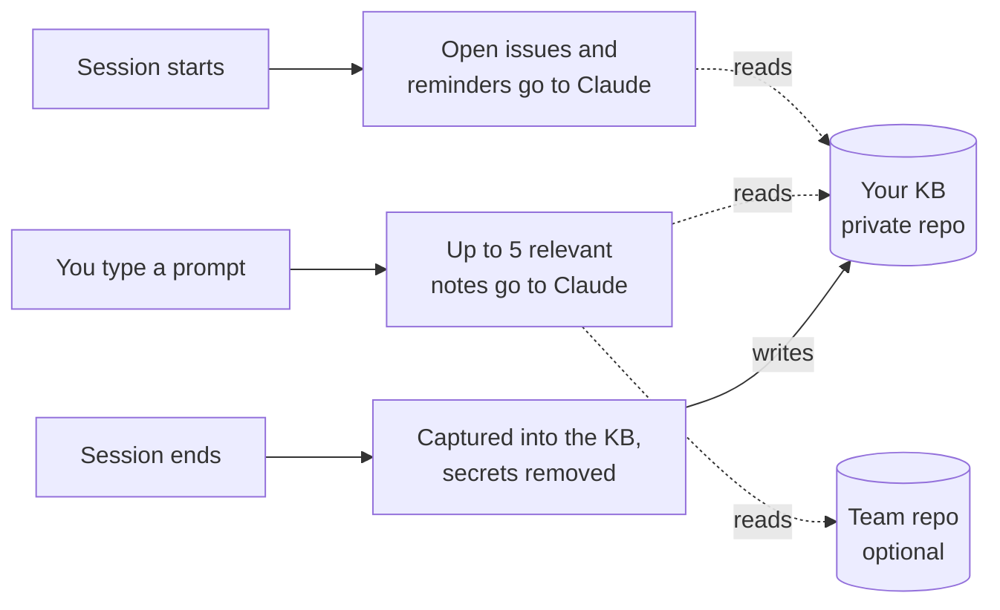

# Leyden

A knowledge base (KB) that fills itself from your Claude Code sessions and feeds back into the next
one. Plain markdown in your own private git repo. macOS only.

- **Session start:** Claude already knows your open issues and due reminders.
- **Every prompt:** Claude first checks what you (and your team) already know about it.
- **Session end:** the fix, root cause and setup details are written to your KB, secrets removed.
  Sessions that touch nothing you track are skipped.
- **Once a day:** your KB is backed up to your private repo.



## Requirements

- macOS, Python 3.9+ (standard library only), git with `user.name` and `user.email` set.
- [Claude Code](https://docs.claude.com/en/docs/claude-code/overview) CLI with
  `claude -p --restricted` support (run `claude update` if capture says it is missing).
- Optional: GitHub CLI (`gh`) to create your backup repo and open team pull requests.

## Setup (about 2 minutes)

```bash
cd <your-workspace>          # the folder that holds your other repos
git clone <url-of-this-repo> leyden
claude                       # then say: set up leyden
```

Claude asks three things (solo or team, where to back up your KB, which words fit your work),
shows the plan, asks once, and sets it up. Prefer a terminal:

```bash
./leyden/bin/leyden setup --personal <repo-url | new | local> [--vocabulary <name>] [--team <url>]
```

Details: [solo setup](docs/setup-individual.md) · [team setup](docs/setup-team.md)

## Use it

Just talk to Claude:

- "What is open?" / "What is going stale?"
- "What do we know about certificate expiry errors?"
- "Remind me tomorrow at 10 to follow up on the staging cleanup."
- "Push the acme export-timeout issue to the team repo." (new branch and pull request, after you confirm)
- "Is Leyden healthy?" / "Update Leyden."

Keep your KB in a private repo. Never store passwords, keys or customer files in it: write where a
secret lives, not the secret.

## Privacy: what leaves your machine

No server, no account, no telemetry.

- **KB commits** go only to the git remote you chose at setup (or nowhere, if local).
- **Capture** runs your own `claude` CLI under your Claude Code account, like any session. Its cost
  is logged (`leyden metrics`).
- **Search** adds up to 5 matching notes to your prompt, so they reach Claude in that session.
- **Optional:** the weekly sweep (your `claude` CLI and its connectors, read-only), team sharing
  (only when you ask), and the `graph.html` dashboard (loads D3, marked and DOMPurify from cdnjs).

Redaction is pattern-based and can miss an unknown format. Report misses privately:
[SECURITY.md](SECURITY.md).

## Uninstall

1. `./leyden/bin/leyden sweep unschedule` (only if you scheduled the sweep).
2. Remove the three `leyden/tools/` hooks from `<workspace>/.claude/settings.json`, the
   "Knowledge base (Leyden)" section from `<workspace>/CLAUDE.md`, and the skill links in
   `<workspace>/.claude/skills/` that point into `leyden/skills/`.
3. Delete the `leyden/` folder. Your KB and its remote are left as they are.

## More

[CONVENTIONS.md](CONVENTIONS.md) · [tools/README.md](tools/README.md) ·
[CHANGELOG.md](CHANGELOG.md) ·
[CONTRIBUTING.md](CONTRIBUTING.md)

## License

[MIT](LICENSE), Copyright (c) 2026 The Leyden Authors. The secret redactor adapts rules from
[gitleaks](https://github.com/gitleaks/gitleaks) (MIT) and
[detect-secrets](https://github.com/Yelp/detect-secrets) (Apache-2.0); see [NOTICE](NOTICE).
Leyden is an independent project, not made or endorsed by Anthropic.
